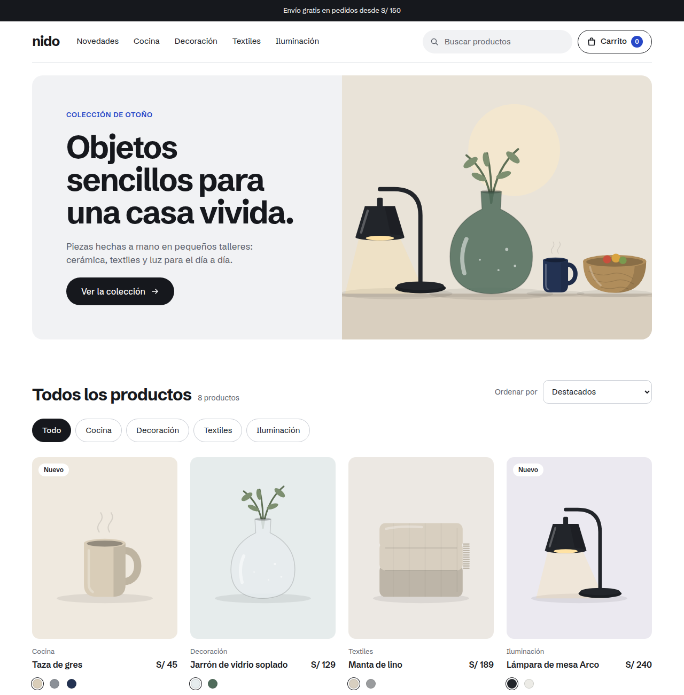
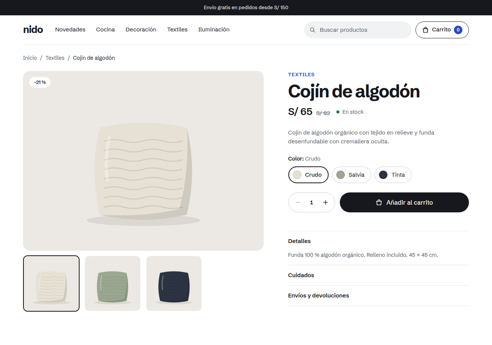
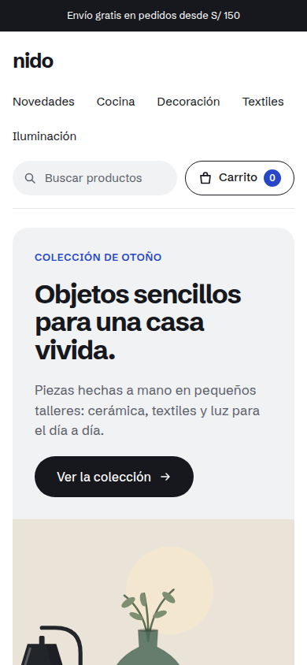

# Nido · Tienda online

Tienda online de demostración de objetos para casa: catálogo con búsqueda y filtros, ficha de producto con variantes de color, carrito persistente y un checkout en tres pasos con validación de formularios y pago simulado.



> Proyecto de portafolio. Los productos y precios son ficticios y no se realizan cobros.

## Funcionalidades

- **Catálogo**: búsqueda sin distinguir tildes ni mayúsculas, filtros por categoría y ordenación por precio o novedad. El estado vive en la URL (`/?cat=cocina&orden=precio-asc&q=taza`), así que cualquier vista se puede compartir o recargar.
- **Ficha de producto**: selector de color que actualiza la imagen, selector de cantidad, información desplegable y productos relacionados.
- **Carrito**: se guarda en `localStorage`, agrupa por producto y color, limita las unidades por línea, aplica cupones (prueba con `NIDO10`) y avisa de cuánto falta para el envío gratis.
- **Checkout**: datos de envío y pago validados con Zod, formato automático del número de tarjeta y la fecha de vencimiento, coste de envío según el método y el importe, y página de confirmación con el resumen del pedido.
- **Accesibilidad**: HTML semántico, etiquetas y errores asociados a cada campo (`aria-describedby`), estados `aria-pressed` y `aria-current`, regiones `aria-live`, foco visible y objetivos táctiles de al menos 44 px.
- **Diseño adaptable**: maquetación fluida con `flex-wrap` y `clamp()` que funciona desde 320 px sin media queries específicas.
- **Ilustraciones propias**: cada producto se dibuja en SVG y cambia de color con la variante elegida, sin depender de fotos externas. Si un producto tiene fotos (`images`), se muestran en su lugar.

<p>
  
  
</p>

## Tecnologías

| | |
| --- | --- |
| Interfaz | React 19, React Router 7 |
| Lenguaje | TypeScript |
| Estilos | Tailwind CSS 4 |
| Estado | Zustand (con `persist`) |
| Formularios | React Hook Form + Zod |
| Pruebas | Vitest |
| Compilación | Vite |

## Cómo ejecutarlo

Requiere Node.js 22 o superior.

```bash
npm install
npm run dev      # servidor de desarrollo en http://localhost:5173
npm test         # pruebas unitarias
npm run build    # comprobación de tipos y build de producción en dist/
npm run preview  # sirve la build de producción
```

Para probar el pago usa la tarjeta `4242 4242 4242 4242`, cualquier fecha futura y cualquier CVC de 3 dígitos.

## Estructura

```
src/
├── components/   Piezas reutilizables (tarjeta de producto, ilustraciones, stepper, campos…)
├── data/         Catálogo de productos
├── lib/          Lógica pura: totales, cupones, envíos, esquemas de validación y formato
├── pages/        Catálogo, ficha, carrito, checkout y 404
├── store/        Estado global del carrito
└── types.ts
```

La lógica de negocio (totales, descuentos, envío gratis, validación de tarjetas y el carrito) está separada de la interfaz y cubierta por pruebas en `src/lib/*.test.ts` y `src/store/cart.test.ts`.

## Despliegue

Es una SPA estática. Se incluyen las reglas de reescritura para que las rutas funcionen al recargar:

- **Vercel**: `vercel.json`
- **Netlify**: `public/_redirects`

En ambos casos el comando de build es `npm run build` y el directorio de salida, `dist`.
